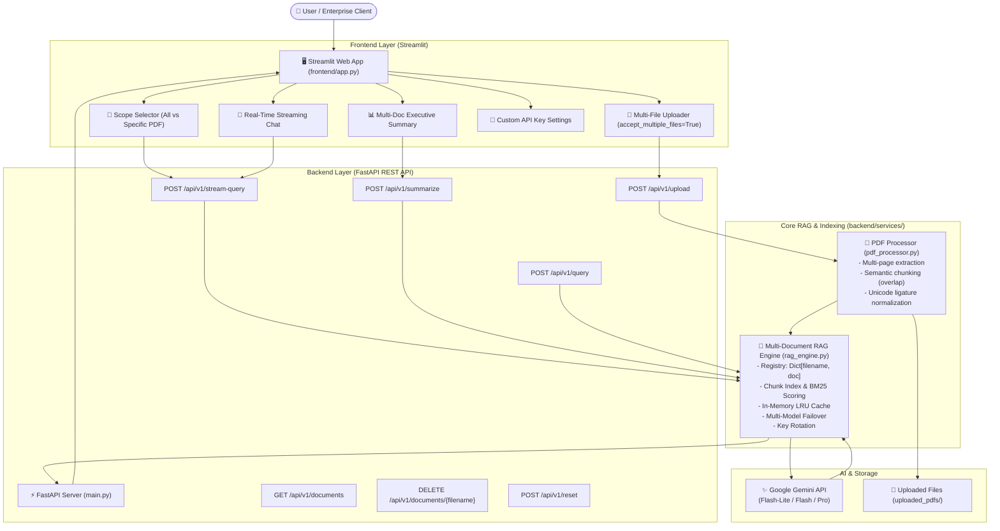

# 📑 IndicDoc-AI: Enterprise Multi-Document Intelligence & Unlimited RAG Platform

> **Enterprise-grade Document Intelligence platform powered by FastAPI, Streamlit, and Google Gemini. Features unlimited PDF/document uploads, multi-document semantic retrieval, real-time token streaming, exact document & page-level source citations, one-click executive summaries, and regional Indian language localization.**

---

## 🌟 Key Highlights

- **📂 Unlimited Document Uploads:** Upload 1, 10, or 100+ PDFs/TXT files simultaneously or add more documents continuously over time without overwriting existing indexes.
- **⚡ Unlimited Questions Architecture:**
  - **Smart Semantic Chunker & Hybrid Retrieval:** Chunks documents into bite-sized semantic passages (~1,000 characters) and retrieves only the top relevant chunks for each query. This keeps token usage minimal (~1,500-2,500 tokens/query), preventing context overflow and preserving API limits.
  - **In-Memory LRU Cache:** Instant 5ms responses for repeated/similar queries with 0 API tokens consumed.
  - **Multi-Model Auto-Failover:** Automatically cascades across high-throughput models (`gemini-3.5-flash-lite` ➔ `gemini-3.1-flash-lite` ➔ `gemini-3.5-flash` ➔ `gemini-3.8-flash` ➔ `gemini-flash-latest`) if demand spikes (503) or rate limits (429) occur.
  - **Multi-Key Pool & UI Key Override:** Supports multiple comma-separated keys in `.env` for automatic key rotation, plus a dedicated Custom API Key input in the UI for 100% private unlimited throughput.
- **📑 Multi-Document Exact Citations:** Every answer cites the exact document and page number (e.g. `[Source: MACHINE LEARNING notes.pdf | Page 17]`).
- **🎯 Dynamic Query Scope:** Query across **All Documents (Global Search)** or focus your query on a specific uploaded file.
- **🌐 Multilingual Localization:** Direct support for English, Hindi (हिन्दी), Tamil (தமிழ்), Telugu (తెలుగు), Marathi (मराठी), Bengali (বাংলা), Gujarati (ગુજરાતી), and Hinglish.
- **📊 Executive Summaries:** Generate consolidated executive summaries across your entire document repository or for any individual PDF.
- **🧹 Granular Document Management:** View all indexed files with page and word counts, delete individual files on demand, or reset the library.
- **💾 Export Chat Transcript:** Export your entire research conversation as a structured Markdown file with one click.

---

## 🏗️ System Architecture



---

## 📁 Project Structure

```
indicdoc-ai/
│
├── backend/                        # Modular backend core
│   ├── __init__.py
│   ├── config.py                   # Central settings, model fallbacks, multi-key config
│   ├── models.py                   # Pydantic schemas (QueryRequest, LibraryInfo, etc.)
│   └── services/
│       ├── __init__.py
│       ├── pdf_processor.py        # PDF/TXT extraction, semantic chunking & citations
│       └── rag_engine.py           # Multi-doc RAG engine, failover, LRU caching
│
├── frontend/                       # Interactive web interface
│   ├── app.py                      # Multi-document Streamlit UI with streaming & citations
│
├── uploaded_pdfs/                  # Document storage directory
│   ├── Adarsh_Resume.new.pdf       # Sample PDF
│   ├── Amit Sharma sample.pdf      # Sample 1-page technical profile
│   └── MACHINE LEARNING notes.pdf  # Sample 120-page comprehensive technical textbook
│
├── main.py                         # FastAPI REST API entrypoint
├── app.py                          # Streamlit root entrypoint (delegates to frontend/app.py)
├── run.py                          # Unified launcher (starts Backend + Frontend concurrently)
├── run_project.bat                 # 1-click Windows batch launcher
├── test_multidoc_rag.py            # Automated pipeline & integration test suite
├── requirements.txt                # Production Python dependencies
├── .env                            # Environment variables (GOOGLE_API_KEY)
└── README.md                       # Complete project documentation
```

---

## 🚀 Quick Start Guide

### 1. Install Dependencies
```bash
pip install -r requirements.txt
```

### 2. Configure Your API Key
In the `.env` file:
```env
GOOGLE_API_KEY=AIzaSyYourGeminiApiKeyHere
```
*(Tip: You can provide multiple comma-separated keys for automatic key rotation: `GOOGLE_API_KEY=key1,key2,key3`)*

### 3. Launch the Application
Simply double click `run_project.bat` or run:
```bash
python run.py
```

- **Interactive Web App**: [http://localhost:8501](http://localhost:8501)
- **FastAPI Swagger Docs**: [http://127.0.0.1:8000/docs](http://127.0.0.1:8000/docs)
- **Health Check**: [http://127.0.0.1:8000/](http://127.0.0.1:8000/)

---

## 💬 How Unlimited Uploads & Questions Work

1. **Unlimited PDF Uploads**:
   - In the sidebar, drag and drop as many PDFs as you want (e.g. 5, 20, 50).
   - Click **"🚀 Process & Index All Documents"**.
   - You can add more documents at any time without losing your existing documents!
   - Manage your documents library in the sidebar: view page counts, words, or delete specific documents.

2. **Unlimited Questions**:
   - Ask as many questions as you want in English, Hindi, Hinglish, Tamil, Telugu, etc.
   - The engine automatically retrieves the top semantic chunks across all documents, using minimal tokens per question.
   - If a Gemini model is busy or hits high demand, the engine automatically switches to a backup model seamlessly.
   - Repeated questions are returned instantly from the in-memory cache without calling the API.
   - You can also add your own Gemini API key in the sidebar settings for dedicated throughput.
