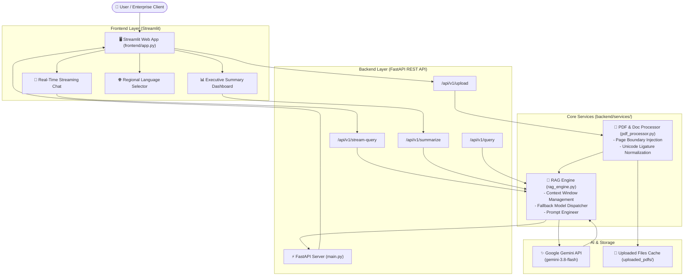

# 📑 IndicDoc-AI: Enterprise Multilingual Document Intelligence & Native-Context RAG

> **Enterprise-grade Document Intelligence platform powered by FastAPI, Streamlit, and Google Gemini. Features real-time token streaming, exact page-level source citations, one-click executive summaries, and regional Indian language localization.**

---

## 🌟 Key Highlights

- **Native Large-Context Processing:** Utilizes Gemini's context window (supporting 120+ pages / 400,000+ characters) to analyze comprehensive documents without fragmented chunking or loss of broader context.
- **Precise Page Citations:** Automatically injects structural page anchors (`--- Page X ---`) during parsing so answers cite the exact pages where information is found.
- **Multilingual Localization:** Direct support for English, Hindi (हिन्दी), Tamil (தமிழ்), Telugu (తెలుగు), Marathi (मराठी), Bengali (বাংলা), Gujarati (ગુજરાતી), and Hinglish.
- **Real-Time Streaming Responses:** Smooth, low-latency token streaming directly in the Streamlit workspace via standard HTTP streaming endpoints.
- **One-Click Executive Summaries:** Instant structured briefings (Overview, Key Highlights, Risks/Obligations, Recommendations) for lengthy legal, regulatory, or technical files.
- **Dynamic Model Fallback:** Built-in resilience mechanism that tries primary models (`gemini-3.8-flash`) and automatically falls back to secondary models if Google API demand spikes occur.
- **Dual Surface:** Premium Streamlit web dashboard + Production-ready FastAPI REST API with interactive Swagger documentation.

---

## 🏗️ System Architecture



---

## 📁 Project Structure

```
indicdoc-ai/
│
├── backend/                        # Modular backend core
│   ├── __init__.py
│   ├── config.py                   # Central settings, model fallbacks, paths
│   ├── models.py                   # Pydantic schemas (QueryRequest, SummaryResponse, etc.)
│   └── services/
│       ├── __init__.py
│       ├── pdf_processor.py        # PDF/TXT extraction, unicode cleaning & page markers
│       └── rag_engine.py           # Gemini calling logic, streaming generator, citations
│
├── frontend/                       # Interactive web interface
│   ├── app.py                      # Modern Streamlit UI with streaming & citations
│
├── uploaded_pdfs/                  # Document storage directory
│   ├── Amit Sharma sample.pdf      # Sample 1-page technical profile
│   └── MACHINE LEARNING notes.pdf  # Sample 120-page comprehensive technical textbook
│
├── main.py                         # FastAPI REST API entrypoint
├── app.py                          # Streamlit root entrypoint (delegates to frontend/app.py)
├── run.py                          # Unified launcher (starts Backend + Frontend concurrently)
├── run_project.bat                 # 1-click Windows batch launcher
├── requirements.txt                # Production Python dependencies
├── requirement.txt                 # Backward-compatible requirements alias
├── .env                            # Environment variables (GOOGLE_API_KEY)
└── README.md                       # Complete project documentation
```

---

## 🚀 Quick Start Guide

### 1. Prerequisites
- **Python 3.11+** installed
- A **Google Gemini API Key** (get one at [Google AI Studio](https://aistudio.google.com/))

### 2. Configure Environment
Check or update your `.env` file in the project root:
```env
GOOGLE_API_KEY=your_gemini_api_key_here
GEMINI_MODEL=gemini-3.8-flash
PORT=8000
FRONTEND_PORT=8501
```

### 3. Install Dependencies
```bash
pip install -r requirements.txt
```

---

## 🖥️ Running the Project

### Option A: 1-Click Unified Launcher (Recommended)
Launch both the **FastAPI Backend** and the **Streamlit Frontend** with a single command:

```bash
python run.py
```
*Or double-click `run_project.bat` on Windows.*

Services will be accessible at:
- **Interactive Web App:** [http://localhost:8501](http://localhost:8501)
- **FastAPI Swagger Docs:** [http://127.0.0.1:8000/docs](http://127.0.0.1:8000/docs)
- **API Health Check:** [http://127.0.0.1:8000/](http://127.0.0.1:8000/)

---

### Option B: Running Services Separately

**Terminal 1 (Backend API):**
```bash
python -m uvicorn main:app --reload --port 8000
```

**Terminal 2 (Frontend Dashboard):**
```bash
streamlit run frontend/app.py --server.port 8501
```

---

## 🔌 API Reference

| Endpoint | Method | Description |
| :--- | :---: | :--- |
| `/` | `GET` | Health check, active model status, and document status |
| `/api/v1/upload` | `POST` | Upload and process a PDF/TXT document with page indexing |
| `/api/v1/stream-query` | `POST` | Stream answers chunk-by-chunk in real time (`text/plain`) |
| `/api/v1/query` | `POST` | Structured JSON answer with verified page citations |
| `/api/v1/summarize` | `POST` | Generates a structured multi-section Executive Summary |
| `/api/v1/document` | `GET` | Retrieves active document metadata (pages, word count) |
| `/api/v1/reset` | `POST` | Clears active document from memory |
| `/docs` | `GET` | Interactive OpenAPI / Swagger UI |

### Example Query Request (`POST /api/v1/query`)
```json
{
  "question": "What penalty clauses or liability terms are mentioned?",
  "target_language": "Hindi (हिन्दी)"
}
```

---

## 💡 Usage Walkthrough

1. **Upload Document:** Open [http://localhost:8501](http://localhost:8501), expand the sidebar, and upload any PDF (e.g. `uploaded_pdfs/MACHINE LEARNING notes.pdf`). Click **Process & Index Document**.
2. **Review Stats:** Note the page count, word count, and green backend connection badge.
3. **Generate Summary:** Click **📊 Executive Summary** to inspect the 4-part breakdown.
4. **Chat & Interrogate:** Type questions or click suggestion chips. The response streams with page citation tags (e.g. `[Page 12]`).
5. **Switch Languages:** Select Hindi, Tamil, or Hinglish from the language dropdown to receive localized answers instantly.

---

## 🛡️ License & Acknowledgments
Built with ❤️ for high-performance enterprise document intelligence. Powered by FastAPI, Streamlit, and Google Gemini.